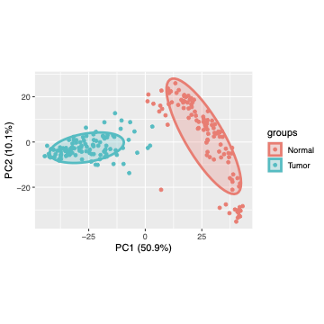
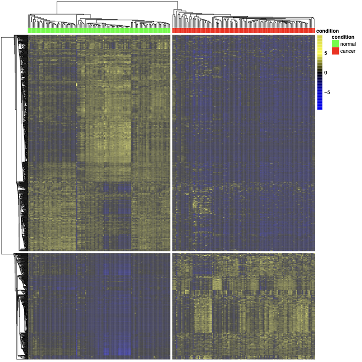
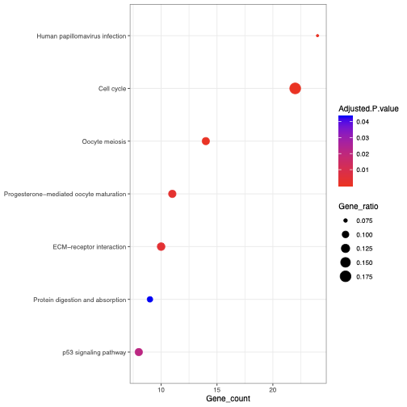

# TCGA Breast Cancer Gene Expression Analysis

**An exploratory R workflow comparing paired tumor and normal tissue in TCGA-BRCA.**

Developed for a Bioinformatics university exam in 2024, this project follows the
analysis from patient matching and expression filtering to differentially
expressed genes, PCA and functional enrichment. The portfolio copy includes the
original exam presentation, result exports and portable analysis scripts.

**R · Paired statistical analysis · PCA · Functional enrichment · TCGA**



*Historical PCA on genes already selected by the tumor/normal comparison.
PC1 explains 50.9% and PC2 10.1% of variance. This is an exploratory visualization
of the selected cohort, not an independent classification evaluation.*

## What this project demonstrates

- Matching tumor and normal samples by TCGA patient identifiers.
- Processing high-dimensional expression data and applying paired statistical tests.
- Exploring expression structure with clustering and PCA.
- Connecting gene lists to pathways and disease annotations with Enrichr.
- Interpreting biological findings alongside statistical and data limitations.

## Results presented at the exam

The reference is the [original 33-slide presentation](docs/Bioinformatics%20-%20BRCA.pdf).
Bundled tables preserve the associated results; the figures below are previews of
original PDF exports.

| Measure | Exam result |
| --- | --- |
| Source matrix, as reported in the slides | 56,602 genes × 1,222 samples |
| Matched cohort | 112 patients, 224 samples |
| Selected differentially expressed genes | 1,556 |
| Upregulated / downregulated | 513 / 1,043 |
| Largest positive / negative expression difference | COL10A1 / FABP4 |
| PCA variance, PC1 + PC2 | 50.9% + 10.1% = 61.0% |
| Leading UP KEGG term by adjusted p-value | Cell cycle |
| Leading DOWN KEGG terms | Regulation of lipolysis in adipocytes; PPAR signaling pathway; Axon guidance |



*Row-scaled expression, correlation distance and average-linkage clustering.*



*Archived Enrichr output using KEGG 2021 Human. Term associations support
exploratory interpretation and do not establish a biological mechanism.*

## Run the analysis

Use R from the repository root. CI uses R 4.4.3; the historical package environment
was not recorded. Install the core dependencies:

```bash
Rscript scripts/install_dependencies.R
```

PCA runs immediately from the bundled selected-gene matrix:

```bash
Rscript scripts/02_pca.R
# Writes scores, loadings, explained variance and a new plot under runs/PCA/.
```

For differential expression, provide the original unlogged expression matrix.
It is excluded from Git; see [input format and provenance](data/README.md).

```bash
Rscript scripts/01_differential_expression.R /path/to/matrix_RNAseq_BRCA.txt runs/BRCA
Rscript scripts/02_pca.R runs/BRCA runs/PCA-rerun
```

Optionally query the enrichment service for both gene directions:

```bash
Rscript scripts/install_dependencies.R --enrichment
Rscript scripts/03_enrichment.R results/exam/BRCA/DEG.txt runs/enrichment
```

The enrichment command needs internet access and submits the gene symbols to
Enrichr. Live results can differ from historical exports. Commands require an
empty output directory and record their R session. Archived exam outputs remain
under `results/exam/`.

## Method and limitations

The historical workflow applies `log2(x + 1)`, removes low-IQR genes, filters on
absolute mean log-expression difference ≥ 1, then applies paired t-tests and
Benjamini-Hochberg adjustment with a 0.01 threshold. The portfolio scripts retain
that procedure so its meaning stays aligned with the exam.

The fold-change prefilter affects the multiple-testing interpretation. PCA is
computed after label-based gene selection, and there is no held-out prediction
experiment or independent cohort. Input normalization and download-release
metadata were not fully recorded. These are material limits of the original
study, explained in [methodology](docs/METHODOLOGY.md).

## Repository guide

```text
scripts/                 Portable expression, PCA, enrichment and artifact checks
results/exam/BRCA/       Original gene lists, selected expression matrix and figures
results/exam/PCA/        Original PCA figures
docs/                    Original presentation, methodology, provenance and previews
archive/code/            Unmodified core R scripts from the exam project
data/README.md           Input requirements and missing provenance details
.github/workflows/       Artifact validation and R execution checks
```

Run the dependency-free historical artifact checks with Python 3:

```bash
python3 scripts/verify_results.py
```

CI also runs PCA against the archived matrix, checks its variance against the
slides, and exercises the expression workflow on synthetic paired data. Those
checks do not constitute a fresh full-data reproduction of the exam.
See [validation](docs/VALIDATION.md) and [provenance](docs/PROVENANCE.md).

## References and attribution

The [presentation](docs/Bioinformatics%20-%20BRCA.pdf) contains the bibliography
used for biological interpretation. Data are TCGA-derived; pathway and disease
annotations come from the named enrichment databases. Original course scaffolding
and third-party material retain their provenance; see the attribution notes above.

Maintained by **Lorenzo Soannini**.
